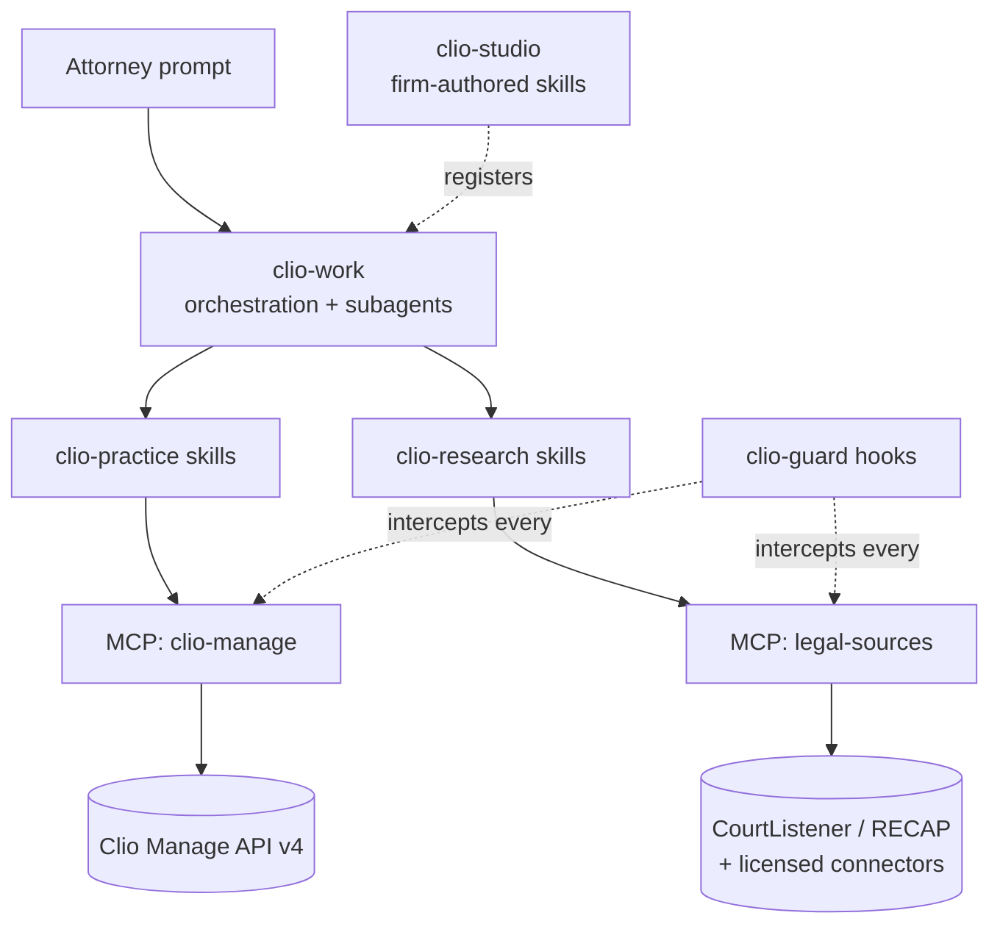

# Clio AI Capability Parity — Claude Plugin & Skill Specification

Status: Draft for approval
Owner: dewainr
Date: 2026-09-13
Scope: A Claude Code plugin marketplace that reproduces Clio's four AI capability layers against a firm's own Clio tenant and public legal sources.

---

## 1. Purpose & Scope

Clio's AI surface is four distinct products with four distinct jobs. This spec maps each onto Claude Code primitives — plugins, Agent Skills, MCP servers, subagents, and hooks — and defines the build in enough detail to hand to Claude Code as an implementation contract.

**In scope:** a single marketplace repo shipping five plugins that together cover practice-data assistance, legal research with citation verification, agentic multi-step execution, firm-specific workflow authoring, and the confidentiality controls that make the other four defensible.

**Out of scope:** replacing Clio Manage itself. This spec assumes Clio remains the system of record. We are duplicating the *AI layer* over that record, not the record.

**A note on sourcing.** The capability descriptions in §2 are taken as given from the originating conversation. Corporate details in that conversation (acquisition values, funding rounds, launch dates, add-on pricing) were not independently verified and do not affect anything in this build, so they are omitted rather than restated. One item *was* verified because it changes the design: **there is no official, Clio-endorsed MCP server.** Every Clio MCP integration available today is community-built and ships an explicit "not endorsed or sponsored by Clio" disclaimer. §5 is written accordingly.

---

## 2. Capability Map

| Clio layer | What it does | Our equivalent | Primitive |
|---|---|---|---|
| **Manage AI** | In-app assistant over practice data: matter summaries, billing narratives, client comms drafting, document analysis, time/task entry by command | `clio-practice` | MCP server + 6 skills |
| **Vincent** | Research & analysis: case law, statutes, dockets, contract review, multi-jurisdiction comparison, cited to source | `clio-research` | MCP server + 5 skills |
| **Clio Work** | Agentic layer: executes multi-step tasks from one prompt, shows its work, interruptible and redirectable, built on a "skills infrastructure" | `clio-work` | Subagents + orchestration skills |
| **Vincent Studio** | No-code builder: firms codify their own processes into reusable workflows | `clio-studio` | Skill-authoring skill + firm marketplace |
| *(implicit)* | Clio's compliance boundary — the thing you give up by bringing your own model | `clio-guard` | **Hooks** (enforcing, not advisory) |

The fifth row is the one Clio gets for free and we do not. Clio's pitch is that Manage AI stays inside their compliance boundary. When you point Claude at Clio data instead, you own the privilege question — so the boundary has to be built, not assumed. `clio-guard` is not optional garnish; it is the load-bearing piece that makes the other four deployable in a firm.

### 2.1 Layering



Every tool call to either MCP server passes through `clio-guard`'s `PreToolUse` hook before it executes and its `PostToolUse` hook after. There is no path from a skill to client data that bypasses it.

---

## 3. Repository Layout

One marketplace repo, five plugins:

```
clio-parity/
├── .claude-plugin/
│   └── marketplace.json
├── plugins/
│   ├── clio-guard/
│   │   ├── .claude-plugin/plugin.json
│   │   ├── hooks/hooks.json
│   │   └── scripts/{redact.py,audit.py,conflicts.py}
│   ├── clio-practice/
│   │   ├── .claude-plugin/plugin.json
│   │   ├── .mcp.json
│   │   ├── skills/{matter-brief,billing-narrative,time-capture,
│   │   │           client-letter,document-review,intake-triage}/SKILL.md
│   │   └── servers/clio-manage/          # MCP server implementation
│   ├── clio-research/
│   │   ├── .claude-plugin/plugin.json
│   │   ├── .mcp.json
│   │   ├── skills/{caselaw-research,citation-check,jurisdiction-compare,
│   │   │           docket-watch,contract-review}/SKILL.md
│   │   └── servers/legal-sources/
│   ├── clio-work/
│   │   ├── .claude-plugin/plugin.json
│   │   ├── agents/{researcher.md,drafter.md,reviewer.md}
│   │   ├── commands/{matter-workup.md,filing-prep.md}.md
│   │   └── skills/{engagement-plan,work-product-assembly}/SKILL.md
│   └── clio-studio/
│       ├── .claude-plugin/plugin.json
│       └── skills/{firm-workflow-author,workflow-eval}/SKILL.md
```

`plugin.json` fields: `name` (kebab-case), `description`, `version` (semver), `author`, `repository`, `license`. Each plugin versions independently; the marketplace pins them.

---

## 4. `clio-guard` — the trust boundary

Build this **first**. Nothing else ships without it.

Skills are instructions — a model can decline to follow them. Hooks are harness-executed and cannot be talked out of. Every control that carries an ethical or regulatory obligation therefore lives in a hook, not in a SKILL.md.

### 4.1 Controls

| Control | Mechanism | Rule |
|---|---|---|
| Audit log | `PostToolUse` on all `clio-*` MCP tools | Append-only JSONL: timestamp, tool, outcome, Clio user ID, matter ID. **Allowlist arguments** — log IDs, dates, enums only; replace all free text (names, note bodies, search queries) with `[redacted]`. |
| Write gating | `PreToolUse` | Any tool with `write: true` in its manifest requires explicit user confirmation. No exceptions, no "remember this choice" for trust-ledger tools. |
| Trust accounting lockout | `PreToolUse` | Hard deny on any write to trust/IOLTA ledger endpoints. Read-only, always. See §9.3. |
| Conflicts gate | `PreToolUse` on matter-creating tools | Runs `conflicts.py` against contacts + matters for adverse-party name matches; blocks creation on a hit pending human clearance. |
| Egress ceiling | `PreToolUse` on research tools | Denies outbound calls carrying client-identifying strings to any non-allowlisted host. Prevents a research query leaking a client name to a third-party corpus. |
| Retention | Config | Token storage in OS keychain, AES-256-GCM. Never in the repo, never in `.env` committed to git. |

### 4.2 Why the allowlist redaction matters

The prior-art community server (`oktopeak/clio-mcp`) logs an allowlist of IDs/dates/enums and redacts free text. Copy that posture exactly. An audit log that captures search queries and note bodies is itself a confidentiality liability — you have created a second, less-protected copy of privileged material sitting in a plaintext file. Log that a `get_matter` happened; do not log what was in it.

### 4.3 What this does *not* solve

Be honest with the firm about this in the README: the guard secures the boundary between Clio and Claude. It does not govern what happens to the content after it reaches the model. That is a procurement and policy question (zero-retention terms, no-training commitments), not an engineering one. Do not let the plugin's existence imply it has been answered.

---

## 5. `clio-practice` — Manage AI parity

### 5.1 MCP server: `clio-manage`

Wraps the Clio Manage API v4. Confirmed characteristics to build against: OAuth 2.0 authorization with two permission layers (integration access scope × the authenticated user's own Clio role); minor-version pinning via the `X-API-VERSION` header; per-access-token rate limiting returning `429`. Reference: `docs.developers.clio.com`.

**Build vs. adopt.** A mature community server already exposes ~36 tools over this API with the auth and audit posture described above. Evaluate adopting it before writing one. The reasons to write our own: it never touches billing records (we need billing *reads* for narratives), and adopting an unendorsed third-party server into a firm's privileged data path is a diligence decision the firm must make consciously. Either way, the tool contract below is what the skills depend on.

**Tool surface** (`write` column drives the §4.1 gate):

| Tool | Write | Notes |
|---|---|---|
| `authenticate` / `auth_status` / `logout` | – | OAuth device flow; tokens to keychain |
| `list_matters` / `get_matter` | no | Filter by status, practice area, responsible attorney |
| `create_matter` / `update_matter` | **yes** | Creation passes the conflicts gate |
| `search_contacts` / `get_contact` | no | |
| `list_matter_relationships` | no | Party roles — feeds conflicts and captioning |
| `list_documents` / `get_document` | no | |
| `upload_document` | **yes** | |
| `list_folders` / `create_folder` | **yes** (create) | |
| `list_tasks` / `create_task` / `update_task` / `complete_task` | **yes** (mutations) | |
| `list_calendar_entries` / `create_calendar_entry` | **yes** (create) | |
| `list_time_entries` / `log_time_entry` | **yes** (log) | |
| `get_billing_summary` | no | Read-only. Never computes or posts. |
| `list_notes` / `create_note` | **yes** (create) | |
| `list_custom_fields` / `list_matter_stages` | no | Firms model workflow here; skills must read it |
| `list_users` / `get_user` | no | |
| `export_audit_log` | no | Surfaces §4.1 log to the firm |

No delete tools. Ever. Deletion in a matter-management system is a records-retention act with malpractice exposure; it stays in the human UI.

### 5.2 Skills

| Skill | Triggers on | Behavior |
|---|---|---|
| `matter-brief` | "summarize the Henderson matter", "what's the status on…" | Pulls matter, relationships, recent notes, open tasks, upcoming calendar, last activity. Emits a structured brief: posture, deadlines, open items, last contact. Cites every fact to a Clio record ID. |
| `billing-narrative` | "write up my time for…", "clean up these entries" | Converts raw time entries into client-ready narratives in the firm's voice. **Never invents or adjusts duration.** Flags entries that are block-billed or below the firm's descriptiveness threshold rather than silently rewriting them. |
| `time-capture` | "log 1.2 on Henderson for the deposition prep" | Parses natural-language time to a `log_time_entry` call. Confirms matter, duration, activity code, and billable flag before writing. |
| `client-letter` | "draft an update to the client on…" | Status letters, engagement letters, closing letters. Reads matter context, applies firm template from `clio-studio` if one is registered. Always drafts — never sends. |
| `document-review` | "what's in this contract", "review these productions" | Reads documents from the matter, extracts obligations/dates/parties, flags anomalies against a checklist. |
| `intake-triage` | "new inquiry from…" | Structures an inbound inquiry, runs the conflicts gate, drafts a matter record for human approval. Does not create the matter unattended. |

---

## 6. `clio-research` — Vincent parity

This is where honest expectation-setting matters most. See §10.1.

### 6.1 MCP server: `legal-sources`

| Source | Coverage | Auth |
|---|---|---|
| CourtListener REST API v4 | US federal + state appellate opinions; ~18M citations in the lookup index | Public, keyless for core endpoints |
| CourtListener **citation-lookup** | Parses a block of text and resolves every citation found | Public |
| RECAP | Federal PACER dockets and filings | Public read |
| Firm-licensed connector *(pluggable)* | Westlaw / Lexis / vLex if the firm holds a seat | Per-vendor |

The citation-lookup endpoint is the single most valuable thing here and it is free. It exists explicitly as a hallucination guardrail: feed it generated text, get back which citations resolve to real cases and which do not.

**Tools:** `search_opinions`, `get_opinion`, `lookup_citations(text)`, `get_docket`, `list_docket_entries`, `search_statutes`, `compare_jurisdictions`.

### 6.2 Skills

| Skill | Behavior |
|---|---|
| `caselaw-research` | Issue → search → read → synthesize. Every proposition carries a pincite. Emits a research memo with a "cases considered and rejected" section, because what you ruled out is work product too. |
| `citation-check` | **Mandatory post-processing on any drafted document containing citations.** Runs every citation through `lookup_citations`. Any citation that does not resolve is flagged inline and the draft is marked `UNVERIFIED — DO NOT FILE` until cleared. Non-negotiable; see §10.2. |
| `jurisdiction-compare` | Same question across N jurisdictions, output as a comparison table with per-jurisdiction authority. Explicit "no authority found" cells — never an inferred answer. |
| `docket-watch` | Monitors a RECAP docket, summarizes new entries, proposes calendar entries for deadlines (human confirms before write). |
| `contract-review` | Clause extraction against a firm playbook, deviation flagging, fallback-position suggestions. |

---

## 7. `clio-work` — agentic layer parity

Most of this is already native. Clio Work's differentiators — multi-step execution from one prompt, visible reasoning, interrupt-and-redirect, a "skills infrastructure" underneath — describe how Claude Code already operates. The build here is thin and mostly about *packaging* known legal workflows.

| Piece | Implementation |
|---|---|
| Multi-step from one prompt | Native agent loop |
| Shows its work | Native streaming |
| Interrupt and redirect | Native |
| Skills infrastructure | Agent Skills + the `clio-studio` registry |
| **What we add** | Named subagents and pre-built workflow commands |

**Subagents** (`agents/`): `researcher` (read-only, research tools only), `drafter` (no external network), `reviewer` (adversarial pass — reads the draft, does not write it).

**Commands** (`commands/`): `/matter-workup` (facts → issues → research → memo), `/filing-prep` (draft → cite-check → format → deadline calendar).

**Hard rule:** an autonomous run may not perform a `write: true` operation without surfacing it for confirmation. Long-running agentic work in a law practice batches its writes to a review gate at the end; it does not scatter them through an unattended run.

---

## 8. `clio-studio` — Vincent Studio parity

The pitch is "let the firm codify its own expertise into reusable workflows." In our architecture a firm workflow *is* a skill, so this plugin is a skill that writes skills.

`firm-workflow-author` interviews the attorney about a repeatable process — intake for a practice area, a document assembly sequence, a review checklist — and emits a valid `SKILL.md` into the firm's private plugin, along with the reference files it needs.

`workflow-eval` generates test prompts for an authored workflow and reports whether it triggers correctly and produces the expected shape of output. Firms will author skills that never fire because the description is wrong; this catches that.

**Distribution:** the firm's authored skills live in a private plugin in a private marketplace, versioned in git. That gives review, rollback, and attribution — better governance than a no-code builder with no diff.

### 8.1 The Copilot Studio parallel

Worth calling out given this repo's audience. Vincent Studio and Copilot Studio make the same pitch — codify domain expertise into reusable, governed workflows — from opposite directions. Vincent Studio is vertical-first: legal-specific primitives, narrow surface, deep domain fit. Copilot Studio is horizontal: general orchestration, any vertical, with governance (DLP, environments, ALM) as first-class infrastructure. The interesting comparison for a lab or demo is the governance story, not the authoring UX: Copilot Studio's governance zones and solution-based ALM have no obvious Vincent Studio equivalent, while Vincent Studio's legal primitives have no Copilot Studio equivalent without building them. This spec's `clio-guard` + private-marketplace approach is the Claude Code answer to the same problem.

---

## 9. Data model & correctness constraints

### 9.1 Entity contract

Clio is the system of record. Skills hold no state. Every entity is referenced by Clio ID and re-read at use time.

```
Matter (id, display_number, description, status, practice_area,
        responsible_attorney, client → Contact, open_date, custom_fields[])
  ├─ Relationship (contact → Contact, role)   # party roles; drives conflicts
  ├─ Activity (id, type, date, quantity, note, billable, rate)
  ├─ Task (id, name, due_at, assignee, status)
  ├─ CalendarEntry (id, summary, start_at, end_at, court_rule?)
  ├─ Document (id, name, category, latest_version, folder)
  └─ Note (id, subject, detail, created_at, author)
Contact (id, type, name, addresses[], is_client)
Bill (id, matter, state, total, balance)        # READ ONLY
```

### 9.2 No LLM arithmetic on money or dates

Any computation that produces a number a client sees or a date a court enforces runs in a deterministic script, not in generated text.

- Fee totals, discounts, trust balances → `scripts/` Python, results quoted verbatim.
- Deadline computation → a court-rules engine or a human. A model estimating a filing deadline from training knowledge is a malpractice vector. `docket-watch` may *propose* a date from an explicit rule the user supplies; it may not derive one.

### 9.3 Trust accounting

Read-only, enforced at the hook layer (§4.1). Trust/IOLTA handling is bar-regulated, and an erroneous automated trust transaction is a disciplinable event. There is no product benefit here that justifies the risk. The skills may *report* trust balances; nothing writes to them.

---

## 10. Fidelity gaps — what this will not match

State these in the top-level README. A firm discovering them mid-deployment is worse than a firm choosing with them in view.

### 10.1 Research corpus is the real gap

Vincent runs on vLex's licensed corpus. CourtListener is excellent and free but is not equivalent: US-centric, thin on secondary sources and treatises, no editorial headnotes or citator apparatus, and international/multi-jurisdiction coverage is largely absent. **Multi-jurisdiction comparison beyond US jurisdictions is not achievable on free sources.** A firm that needs Vincent-grade research needs a licensed connector behind the `legal-sources` MCP server, and that seat cost likely exceeds the AI add-on it was meant to replace. Say so plainly in the evaluation.

### 10.2 Citation integrity is a hard requirement, not a feature

The failure mode that ends careers in this domain is a fabricated citation in a filing. Clio's answer is a curated corpus with citations back to source. Ours must be mechanical verification: `citation-check` is mandatory, unskippable, and fails closed. A draft that has not passed it is marked unverified. Do not make this configurable.

### 10.3 Native context

Manage AI sits inside Clio and sees everything without an integration hop. We are rate-limited (`429` per token), scoped by OAuth grant, and further constrained by the authenticated user's own Clio role. Expect gaps where a permission was not granted, and surface them as gaps rather than letting a skill silently summarize a partial record. A matter brief built from half the notes, presented as complete, is worse than no brief.

### 10.4 The compliance boundary

Covered in §4.3. Clio's in-house AI keeps data inside their stack; ours does not. This is a real trade the firm makes for better drafting and reasoning, and it is a decision for the firm's general counsel, not for this spec.

---

## 11. Build plan

Each phase ships something testable. Do not start a phase before its predecessor's acceptance test passes.

| Phase | Deliverable | Acceptance test |
|---|---|---|
| **0** | Marketplace scaffold, five `plugin.json` manifests, CI | `/plugin marketplace add` succeeds; all five install and list |
| **1** | `clio-guard` complete | Audit log records a synthetic tool call with free text redacted; a `write: true` call is blocked without confirmation; a trust-write is hard-denied |
| **2** | `clio-manage` MCP, read tools only | `list_matters` + `get_matter` return live data through the guard; every call appears in the audit log |
| **3** | `matter-brief` skill | Produces a brief on a real matter with every fact traceable to a record ID; correctly reports gaps where scope is missing |
| **4** | `clio-manage` write tools + `time-capture`, `billing-narrative` | Time logs only after confirmation; narrative never alters a duration |
| **5** | `legal-sources` MCP + `citation-check` | A document with three real and two fabricated citations flags exactly the two |
| **6** | `caselaw-research`, `jurisdiction-compare` | Research memo carries a pincite per proposition; comparison shows explicit "no authority" cells |
| **7** | `clio-work` subagents + commands | `/matter-workup` runs end to end, batches writes to one review gate |
| **8** | `clio-studio` | An attorney authors a working firm skill in one session; `workflow-eval` confirms it triggers |

---

## 12. Skill authoring conventions

Every `SKILL.md` uses this frontmatter:

```yaml
---
name: matter-brief
description: >
  Summarize the current posture of a Clio matter — deadlines, open tasks,
  recent activity, and last client contact. Use when asked for a status
  update, briefing, or "what's happening with" a named matter or client.
---
```

Rules:

1. **`description` is the trigger.** It is the only thing the model sees when deciding whether to load the skill. Write it around the words an attorney actually says ("where are we on Henderson", "bring me up to speed"), not around internal capability names.
2. **Progressive disclosure.** `SKILL.md` stays short. Push templates, jurisdiction tables, and firm playbooks into `references/` and load on demand.
3. **Cite or abstain.** Any skill that states a fact about a matter cites the Clio record ID. Any skill that states a proposition of law cites authority. A skill that cannot cite says so.
4. **Never send, always draft.** No skill transmits to a client or files with a court. Drafts land in Clio or on disk for a human.
5. **Determinism where it counts.** Money and dates through `scripts/`, per §9.2.

---

## 13. Open questions

1. **Adopt or build the Clio MCP server?** An existing community server covers most of §5.1 with a sound auth and audit posture, but it is unendorsed and excludes billing reads that `billing-narrative` needs. Firm-level diligence call.
2. **Which licensed research connector, if any?** Determines whether §10.1 is a documented limitation or a solved problem, and at what cost.
3. **Court-rules engine for deadlines** — buy, integrate, or keep deadline derivation entirely human (§9.2)?
4. **Multi-user deployment.** This spec assumes per-attorney local install with individual OAuth. A firm-wide shared deployment changes the audit, token-storage, and permission model substantially.
5. **Retention terms** with whatever model provider the firm uses (§4.3) — needs a real answer before any client data flows.
